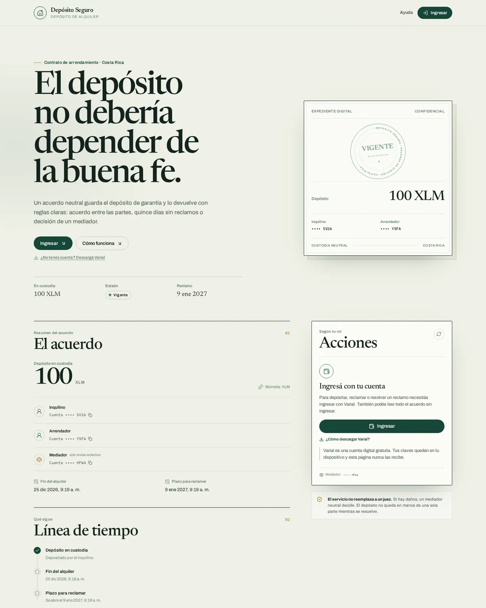

# Depósito Seguro

**Un escrow en Soroban para el depósito de garantía de un alquiler en Costa Rica.**

El inquilino deposita en el contrato. Al terminar el contrato, el dinero solo sale
de tres maneras: con la firma de las dos partes, devolviéndoselo al inquilino
cuando se cumplen 15 días sin disputa, o con la decisión de un árbitro neutral
si hay una disputa. Ninguna de las dos partes puede quedarse con el depósito por
su cuenta.

Práctica individual de smart contracts. Es un problema distinto al de la
hackathon.

---

## 1. El problema

En Costa Rica hay **más de 340 000 hogares que alquilan** (ENAHO 2024, INEC).
Al finalizar el contrato, el depósito de garantía suele quedar en manos del
arrendador, y el inquilino no tiene una forma rápida y neutral de recuperarlo.
Si el arrendador retiene el dinero sin justificación, el camino es reclamar por
la vía administrativa o judicial: lento y caro para montos de uno o dos meses
de alquiler.

En noviembre de 2025 se presentó el **proyecto de ley 25.288**, que propone:

- que el depósito no supere **un mes de alquiler**,
- que se devuelva dentro de los **15 días naturales** siguientes al fin del contrato,
- que solo se descuenten **daños o incumplimientos comprobados**,
- y que retenerlo sin justificación sea **retención indebida** (artículo 223 del
  Código Penal).

El problema es concreto: **el dinero está en poder de una sola parte y no hay
un árbitro neutral, barato y automático.** La ley propone plazos, pero no un
mecanismo técnico que los haga cumplir.

## 2. Por qué un contrato inteligente

Un contrato inteligente no reemplaza al juez ni verifica si una pared quedó
rayada. Lo que sí puede hacer es quitar la posesión unilateral del dinero:

| Sin contrato | Con Depósito Seguro |
|---|---|
| El arrendador tiene el depósito en su cuenta. | Lo tiene el contrato, no una persona. |
| Para recuperarlo hay que negociar o demandar. | A los 15 días el inquilino lo reclama solo. |
| Una parte decide si hay deducción. | Si hay disputa, decide un árbitro o las dos firmas. |
| No hay historial público del acuerdo. | Cada paso emite un evento en Stellar. |

Es importante ser honesto: **el árbitro sigue siendo un punto de confianza**.
El contrato no elimina la necesidad de un mediador; hace que el dinero no esté
bajo el control de una de las partes mientras se resuelve.

¿No bastaría una cuenta multisig? Una multisig también puede guardar el dinero,
pero no impone el plazo de 15 días ni deja un estado público con las reglas. Acá
la devolución automática es parte del contrato, no de la buena voluntad de los
participantes. El camino de adopción natural es una inmobiliaria, una
cooperativa o una municipalidad que ofrezca el escrow como servicio.

## 2.1 Alcance

Esto es una práctica individual y no la idea de la hackathon. El contrato hace
**solo** una cosa: custodiar el depósito de un alquiler y repartirlo según las
reglas de arriba. No cobra alquileres, no verifica identidades y no reemplaza
un contrato de arrendamiento.

## 3. Qué hace el contrato

### Actores

| Actor | Rol |
|---|---|
| **Inquilino** (`tenant`) | Deposita el dinero y puede reclamarlo a los 15 días. |
| **Arrendador** (`landlord`) | Recibe el depósito si hay acuerdo o si el árbitro se lo asigna. Puede abrir una disputa. |
| **Árbitro** (`arbiter`) | Neutral. Solo puede resolver una disputa abierta. Es el `owner` de OpenZeppelin Ownable. |
| **Token** (`token`) | Cualquier Stellar Asset Contract: XLM nativo, USDC u otro token estable. |

### Estados

```
                 fund()
  AwaitingFunds ─────────► Active
                              │  │
             claim()          │  │        dispute()
        (15 días después)     │  └──────────────────► Disputed
                              │                          │
                              ▼                          │ resolve() (árbitro)
                            Closed ◄─────────────────────┤
                              ▲                          │
                              │        settle()          │
                              └──────────────────────────┘
                              (firma inquilino + arrendador)
```

### Funciones

| Función | Quién firma | Qué hace |
|---|---|---|
| `__constructor(tenant, landlord, arbiter, token, amount, lease_end)` | — | Guarda el acuerdo. Corre una sola vez, al desplegar. |
| `fund()` | Inquilino | Mueve el monto exacto del inquilino al contrato. |
| `settle(tenant_refund)` | Inquilino **y** arrendador | Reparte el depósito: `tenant_refund` al inquilino y el resto al arrendador. |
| `claim()` | Inquilino | A los 15 días del fin del contrato, devuelve todo al inquilino si no hay disputa. |
| `dispute(evidence)` | Arrendador | Abre una disputa con el hash de la evidencia. Bloquea el `claim`. |
| `resolve(tenant_refund)` | Árbitro | Cierra la disputa y reparte el depósito. |
| `agreement()`, `status()`, `claim_deadline()`, `arbiter()` | — | Consultas de solo lectura. |

### Línea de tiempo

```
firma del contrato          fin del contrato             +15 días
       │                          │                         │
       ▼                          ▼                         ▼
   fund() ────────────────► lease_end ───────────────► claim_deadline
                                   │                         │
                                   │  dispute()              │ claim()
                                   │  (solo antes del        │ (todo al
                                   │   deadline)             │  inquilino)
                                   ▼                         │
                                Disputed ── resolve() ──────► Closed
```

## 4. Cómo funciona por dentro

- **`DataKey::Agreement`** guarda un único `Agreement` en storage **persistente**:
  partes, token, monto, fechas, estado y hash de evidencia.
- **`require_auth()`** exige la firma de la parte que corresponde. `fund` pide
  la del inquilino; `dispute`, la del arrendador; `settle`, las dos.
- **OpenZeppelin Ownable** guarda al árbitro y protege `resolve`. El árbitro
  puede transferir su rol en dos pasos (`transfer_ownership` +
  `accept_ownership`) si hay que reemplazarlo. No puede sacar fondos con
  `transfer_ownership`: la única función que mueve dinero en una disputa es
  `resolve`, y siempre reparte el monto completo entre las dos partes.
- **Token SAC** (`TokenClient`): el contrato llama `transfer` al token. Si una
  transferencia falla, toda la transacción se revierte.
- **Errores tipados** (`#[contracterror]`): el cliente recibe códigos estables,
  por ejemplo `Error(Contract, #6)` = `TooEarly`.
- **Eventos** (`#[contractevent]`): `Funded`, `Settled`, `Disputed`, `Claimed` y
  `Resolved`, con topics para filtrar por inquilino, arrendador o árbitro.
- **TTL**: cada lectura o escritura renueva la entrada. Si a la entrada le queda
  menos de un día, se extiende a unos 30 días (518 400 ledgers).
- **No hay floats**: los montos son `i128` en la unidad mínima del token
  (stroops si es XLM). El reparto se calcula fuera del contrato y se pasa como
  monto exacto; el contrato valida que esté entre 0 y el depósito.

### Decisiones de seguridad

1. **El monto es fijo.** Se define al desplegar y no se puede cambiar. Evita que
   una parte altere el depósito después.
2. **`settle` pide las dos firmas.** Ni el inquilino ni el arrendador pueden
   mover el dinero solos.
3. **`claim` es la regla por defecto.** Si el arrendador no abre una disputa en
   15 días, el inquilino recupera todo. Es la parte que hace cumplir el plazo.
4. **La disputa tiene ventana.** El arrendador solo puede abrirla entre el fin
   del contrato y el vencimiento de los 15 días. Después, ya no puede bloquear
   el `claim`.
5. **El árbitro no puede retirar libremente.** `resolve` solo existe en estado
   `Disputed` y siempre reparte el 100 % entre inquilino y arrendador.
6. **No hay admin que pueda vaciar el contrato.** El `owner` de OpenZeppelin es
   el árbitro, y su único poder sobre los fondos es `resolve`.
7. **No se guarda la evidencia completa**, solo su hash de 32 bytes. El
   documento (fotos, inventario, presupuesto) vive fuera de la cadena y se puede
   verificar contra ese hash.

## 5. Probarlo

Requisitos: Rust 1.84 o superior, el target `wasm32v1-none` y Stellar CLI
v25.2.0 o superior (para compilar el Wasm).

```bash
rustup target add wasm32v1-none
cargo test
```

Los 19 tests cubren el camino feliz, los errores y los permisos:

| Test | Qué demuestra |
|---|---|
| `constructor_guarda_el_acuerdo` | El constructor guarda partes, monto, fechas y estado inicial. |
| `constructor_rechaza_monto_cero` | No se puede desplegar con un depósito inválido. |
| `constructor_rechaza_plazo_pasado` | El fin del contrato tiene que ser futuro. |
| `fund_mueve_el_deposito_al_contrato` | El dinero sale del inquilino y queda en el contrato. |
| `no_se_fondea_dos_veces` | El depósito se paga una sola vez. |
| `fund_exige_la_firma_del_inquilino` | Sin la firma del inquilino no se puede fondear. |
| `settle_reparte_el_deposito_y_cierra` | Con dos firmas, el reparto es exacto y el contrato queda cerrado. |
| `settle_rechaza_repartos_invalidos` | No se puede repartir más de lo depositado ni montos negativos. |
| `settle_tambien_resuelve_una_disputa` | Las partes pueden acordar sin esperar al árbitro. |
| `claim_espera_los_quince_dias` | Antes del plazo falla; al cumplirlo, el inquilino recibe todo. |
| `claim_exige_la_firma_del_inquilino` | Sin la firma del inquilino nadie puede reclamar el depósito. |
| `disputa_exige_la_firma_del_arrendador` | Sin la firma del arrendador no se abre una disputa. |
| `disputa_bloquea_el_claim` | Una disputa válida impide la devolución automática. |
| `disputa_antes_del_fin_del_contrato_falla` | El arrendador no puede reclamar antes de que termine el alquiler. |
| `disputa_despues_del_plazo_falla` | Pasados los 15 días, la disputa ya no bloquea nada. |
| `arbitro_decide_el_reparto` | El árbitro reparte y ambos reciben su parte. |
| `resolve_sin_disputa_falla` | El árbitro no puede tocar fondos sin una disputa abierta. |
| `resolve_exige_la_firma_del_arbitro` | Sin la firma del árbitro, `resolve` falla. |
| `renueva_el_ttl` | La entrada persistente queda con ~30 días de vida. |

Salida esperada:

```text
running 19 tests
test result: ok. 19 passed; 0 failed
```

## 6. Compilar y desplegar en testnet

```bash
# 1. Compilar a Wasm
stellar contract build

# 2. Crear identidades de prueba
stellar keys generate tenant   --network testnet --fund
stellar keys generate landlord --network testnet --fund
stellar keys generate arbiter  --network testnet --fund

# 3. Elegir el token. Para XLM nativo, obtener la dirección del SAC:
stellar contract id asset --asset native --network testnet

# 4. Desplegar. El monto va en stroops: 1 XLM = 10 000 000.
#    lease_end es un timestamp Unix en segundos; por ejemplo, dentro de 30 días:
#    date -d "+30 days" +%s
stellar contract deploy \
  --wasm target/wasm32v1-none/release/deposito_seguro.wasm \
  --source tenant --network testnet \
  -- \
  --tenant    "$(stellar keys address tenant)" \
  --landlord  "$(stellar keys address landlord)" \
  --arbiter   "$(stellar keys address arbiter)" \
  --token     <TOKEN_SAC> \
  --amount    10000000000 \
  --lease_end <TIMESTAMP>
```

El comando devuelve una dirección `C…`. Guardala como `<CONTRACT_ID>`.

```bash
# 5. El inquilino deposita 1 000 XLM
stellar contract invoke --id <CONTRACT_ID> --source tenant --network testnet -- fund

# 6. Consultar el estado (no pide firma)
stellar contract invoke --id <CONTRACT_ID> --source tenant --network testnet -- status

# 7. Si hay una disputa, el arrendador la abre con el hash de la evidencia
stellar contract invoke --id <CONTRACT_ID> --source landlord --network testnet \
  -- dispute --evidence <HASH_DE_32_BYTES>

# 8. El árbitro decide: 300 XLM al inquilino, el resto al arrendador
stellar contract invoke --id <CONTRACT_ID> --source arbiter --network testnet \
  -- resolve --tenant_refund 3000000000
```

Para el camino de devolución automática, esperá a que pase `lease_end + 15 días`
y ejecutá `claim` con `--source tenant`. En los tests se puede viajar en el
tiempo con `env.ledger().set_timestamp(...)`, sin esperar.

> En testnet, si Friendbot está saturado, reintentá con
> `stellar keys fund tenant --network testnet`.

## 7. Aplicación web

La carpeta [`web/`](web/) tiene una app en React + TypeScript para operar el
contrato sin usar la CLI. Corre contra Soroban RPC y firma con Varial; no tiene
backend ni toca claves privadas.



```bash
cd web
npm install
npm run dev
```

Abrí <http://localhost:5173>. La app usa por defecto un contrato demo **vigente**
en testnet:

`CBOEEBM4MJQ425TV2JZNPCFH7S4YT7SEH3BUTBBEXFYA3HCGSBH4K6BP`

La interfaz se puede leer sin cuenta. Para actuar, el botón **Ingresar** detecta
si Varial está instalado y, si no, muestra una guía con el enlace de descarga.
No hay que saber nada del ecosistema para usarla.

Qué puede hacer cada parte:

| Rol | Acciones en la app |
|---|---|
| Inquilino | Fondear el depósito y reclamarlo al cumplirse los 15 días. |
| Arrendador | Abrir una disputa subiendo un archivo; el navegador calcula su SHA-256. |
| Árbitro | Elegir el reparto con un slider y resolver la disputa. |
| Visitante | Leer el acuerdo, la línea de tiempo y el estado sin ingresar. |

La app detecta el rol comparando la cuenta conectada con `tenant`, `landlord` y
`arbiter`. Si la cuenta no es parte del acuerdo, queda en modo lectura. El
contrato se puede cambiar con `VITE_CONTRACT_ID` en `web/.env` o con
`?contract=C...`.

### Varios acuerdos y varios clientes

La página principal queda como ejemplo. Después de ingresar, **Mis acuerdos**
abre un panel con los acuerdos guardados para esa cuenta:

- Una misma cuenta puede ser **inquilino en un acuerdo y arrendador en otro**.
- En un mismo acuerdo no puede ser inquilino y arrendador: el constructor exige
  que las tres partes sean distintas (`InvalidParties`, error #3).
- Cada acuerdo se comparte con un enlace (`?contract=C...`). La otra parte lo
  abre, ingresa con su cuenta y lo guarda en **Mis acuerdos**.
- Para clientes distintos podés usar cuentas de Varial distintas. Cada cuenta
  tiene su propia lista de acuerdos.
- En este prototipo la lista se guarda en `localStorage` del navegador. Para
  usarla desde otro dispositivo hay que volver a agregar el enlace. Una versión
  de producción necesita un registro o indexador de acuerdos por cuenta.

El panel se puede abrir directo con `?view=cuenta`.

> El acuerdo mutuo (`settle`) no está en la interfaz porque requiere dos firmas
> en la misma transacción. La app cubre las acciones de una sola cuenta; el
> `settle` queda disponible en la CLI y en los tests.

Más detalles en [`web/README.md`](web/README.md).

## 8. Demo ya ejecutada en testnet

Esta versión quedó desplegada y probada el **25 de noviembre de 2026** con XLM
nativo. No es una maqueta: las transacciones están en el explorador. El contrato
que usa la app por defecto es otro, vigente y con 100 XLM:
`CBOEEBM4MJQ425TV2JZNPCFH7S4YT7SEH3BUTBBEXFYA3HCGSBH4K6BP`.

| Dato | Valor |
|---|---|
| Contrato | [`CDVZ6Z3Q23U7ZL532Z2PQCFSYFBX6INUBEZ4RZVSTZSE2NSN4TY4PBU7`](https://stellar.expert/explorer/testnet/contract/CDVZ6Z3Q23U7ZL532Z2PQCFSYFBX6INUBEZ4RZVSTZSE2NSN4TY4PBU7) |
| Wasm hash | `dcda2e977fa3cf89b0b2e23a35e61b1e5dce3807709f4ea440dc7befae4cb81a` |
| Token | XLM nativo (`CDLZFC3SYJYDZT7K67VZ75HPJVIEUVNIXF47ZG2FB2RMQQVU2HHGCYSC`) |
| Depósito | 100 XLM (`1000000000` stroops) |
| Deploy | [`b8eca9cc…07e5344`](https://stellar.expert/explorer/testnet/tx/b8eca9cc7b06765a62d30909cff40ff65a1cc49181893cd11a7486c7607e5344) |
| Fondeo | [`a06b8091…6cb632`](https://stellar.expert/explorer/testnet/tx/a06b80919b2dfe8d97b6ce71469801c0e3711df937ceae2b53a0c3839e6cb632) |
| Disputa | [`91759dce…05ccba`](https://stellar.expert/explorer/testnet/tx/91759dcec4fd7d60205a15746cb6b13f938ccefa200f67301d14d2c84205ccba) |
| Resolución | [`074bdfca…070661`](https://stellar.expert/explorer/testnet/tx/074bdfca266376e28fa1dba2f9488864062818fa31e8194be1383ec498070661) |

Flujo ejecutado:

1. Se desplegó con `lease_end = 1795618926` (25 nov 2026, 15:02 UTC).
2. El inquilino fondeó 100 XLM.
3. Al terminar el contrato, el arrendador abrió una disputa con el hash
   `7099855f…a79ea2`.
4. `claim` del inquilino falló con `Error(Contract, #5)` (`InvalidState`),
   porque la disputa estaba abierta.
5. El árbitro resolvió: 30 XLM al inquilino y 70 XLM al arrendador.
6. El estado final quedó en `Closed`.

## 9. Limitaciones y siguientes pasos

- **El árbitro es un punto de confianza.** Si desaparece, una disputa puede
  quedar bloqueada. Una versión de producción podría agregar un plazo máximo
  para resolver (por ejemplo, 60 días) y devolver el depósito al inquilino si el
  árbitro no actúa.
- **El contrato no verifica daños.** Solo guarda el hash de la evidencia y deja
  la decisión al árbitro. La calidad de esa decisión depende del árbitro.
- **El depósito no está protegido de la volatilidad.** Usar un token estable
  (USDC) o XLM con el monto acordado; si el token cambia de precio, el valor
  real del depósito cambia.
- **Reconocimiento legal.** Un escrow en un contrato inteligente no sustituye
  un contrato de arrendamiento ni una orden judicial. Es un prototipo técnico
  para mostrar cómo se podría hacer cumplir el plazo.
- **Privacidad.** Las direcciones y los montos son públicos en Stellar. Los
  documentos de la evidencia quedan fuera de la cadena.
- **Producción.** Antes de usar dinero real: auditoría, pruebas de integración
  con la wallet, token estable, y un árbitro con reputación verificable.

## 10. Fuentes

- CR Hoy, *Frente Amplio propone plan para garantizar devolución del depósito de
  alquiler en este plazo*, 12 de noviembre de 2025:
  <https://crhoy.com/nacionales/frente-amplio-propone-plan-para-garantizar-devolucion-del-deposito-de-alquiler-en-este-plazo>
  (expediente 25.288; 340 000 hogares en alquiler según ENAHO 2024).
- Ley General de Arrendamientos Urbanos y Suburbanos, Ley 7527, artículo 59.
- OpenZeppelin Stellar Contracts, módulo `ownable`:
  <https://github.com/OpenZeppelin/stellar-contracts>
- Documentación de Soroban SDK:
  <https://docs.rs/soroban-sdk/latest/soroban_sdk/>
