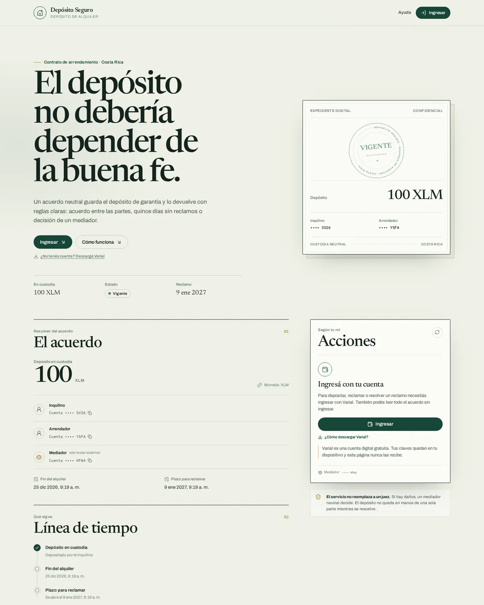
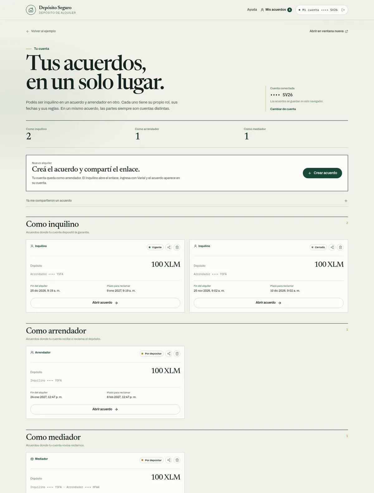

# Depósito Seguro · Web

Aplicación pequeña para operar el contrato [`DepósitoSeguro`](../src/lib.rs)
desde el navegador. No hay backend: Varial firma y la app habla directo con
Soroban RPC.



## Qué permite hacer

| Si sos… | Podés… |
|---|---|
| Inquilino | Fondear el depósito y reclamarlo cuando se cumplen los 15 días. |
| Arrendador | Abrir una disputa con el hash SHA-256 de la evidencia. |
| Árbitro | Resolver la disputa y repartir el depósito entre las dos partes. |
| Cualquiera | Leer el acuerdo, las fechas y el estado sin ingresar. |

La app detecta el rol comparando la cuenta conectada con las direcciones del
contrato. Si la cuenta no es parte del acuerdo, queda en modo lectura.

Después de ingresar, el botón **Mis acuerdos** abre un panel con los acuerdos
guardados para esa cuenta. Una cuenta puede ser inquilino en un acuerdo y
arrendador en otro; en un mismo acuerdo las partes deben ser cuentas distintas.
Los acuerdos se guardan por cuenta en `localStorage`; para otro dispositivo hay
que volver a pegar el enlace. El panel también se abre con `?view=cuenta`.



Para agregar un acuerdo, la otra parte comparte un enlace con
`?contract=C...`; la app lee el acuerdo y solo lo guarda si la cuenta conectada
participa como inquilino, arrendador o mediador.

El acuerdo mutuo (`settle`) no está en la interfaz porque necesita las firmas
del inquilino y del arrendador en la misma transacción. Se puede ejecutar desde
la CLI o desde los tests. La app prioriza las acciones que puede firmar una sola
wallet.

## Correrla

```bash
cd web
npm install
npm run dev
```

Abrí <http://localhost:5173>.

Para compilar a producción:

```bash
npm run build
npm run preview
```

## Configuración

La app usa testnet por defecto y el contrato demo:

```
CBOEEBM4MJQ425TV2JZNPCFH7S4YT7SEH3BUTBBEXFYA3HCGSBH4K6BP
```

Podés cambiar el contrato desde el pie de la página (`Cambiar contrato`), con
un query param (`?contract=C...`) o creando un `.env` a partir de
`.env.example`:

| Variable | Qué es |
|---|---|
| `VITE_CONTRACT_ID` | Dirección `C…` del contrato. |
| `VITE_RPC_URL` | RPC de Soroban. Por defecto, testnet. |
| `VITE_NETWORK_PASSPHRASE` | Passphrase de la red. |
| `VITE_READ_SOURCE` | Cuenta pública usada para simular lecturas sin wallet. |

La app se puede leer sin cuenta. Para actuar, el botón **Ingresar** detecta si
Varial está instalado y, si no, abre una guía con los pasos de descarga. También
hay un enlace directo en el hero, en las acciones y en las preguntas frecuentes.

Requisitos para firmar:

1. Extensión [Varial](https://varialwallet.com) instalada y desbloqueada.
2. Red configurada en **Testnet**.
3. La cuenta conectada debe ser el inquilino, el arrendador o el mediador del
   contrato.
4. Saldo de testnet para el depósito y las fees.

Si Friendbot está saturado, se puede fondear la cuenta desde Stellar Laboratory
o con `stellar keys fund <nombre> --network testnet`.

## Probar tu propio contrato

Desplegalo desde la raíz del repo (ver el README principal) y usá su dirección
en la app. Por ejemplo:

```bash
stellar contract deploy \
  --wasm target/wasm32v1-none/release/deposito_seguro.wasm \
  --source tenant --network testnet \
  -- \
  --tenant    "$(stellar keys address tenant)" \
  --landlord  "$(stellar keys address landlord)" \
  --arbiter   "$(stellar keys address arbiter)" \
  --token     "$(stellar contract id asset --asset native --network testnet)" \
  --amount    1000000000 \
  --lease_end "$(date -d '+30 days' +%s)"
```

Después:

1. Abrí la app con `?contract=<CONTRATO>`.
2. Ingresá con la cuenta del inquilino y depositá.
3. Para probar un reclamo, esperá al fin del contrato o desplegá con un
   `lease_end` cercano.
4. Ingresá con la cuenta del mediador para resolver.

## Notas técnicas

- **Stack:** React 19, TypeScript, Vite, `@stellar/stellar-sdk`,
  `@stellar/varial-sdk`.
- **Lecturas:** se simulan con `simulateTransaction`; no piden firma.
- **Escrituras:** `prepareTransaction` → firma en Varial →
  `sendTransaction` → `pollTransaction`.
- **Privacidad:** la app no pide ni guarda claves privadas. La evidencia se
  hashea en el navegador; el archivo no se sube. El hash usa `crypto.subtle`,
  que requiere HTTPS o `localhost`.
- **Red:** la app está pensada para testnet. Para mainnet hay que cambiar RPC,
  passphrase y el contrato.
- **Bundle:** el SDK de Stellar pesa; para una demo es aceptable. En producción
  conviene separar el cliente del contrato o usar los bindings generados por
  `stellar contract bindings typescript`.

## Relación con el contrato

La interfaz no inventa estado: todo lo que muestra viene de
`agreement()` y `arbiter()`. Las acciones llaman exactamente a `fund`, `claim`,
`dispute` y `resolve` del contrato. Los errores del contrato se traducen a
mensajes legibles con sus códigos (`Error(Contract, #n)`).
